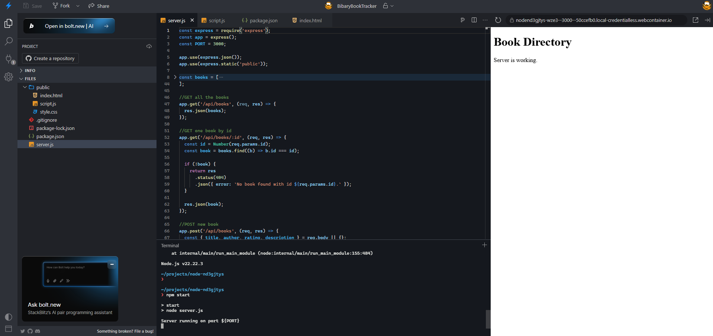
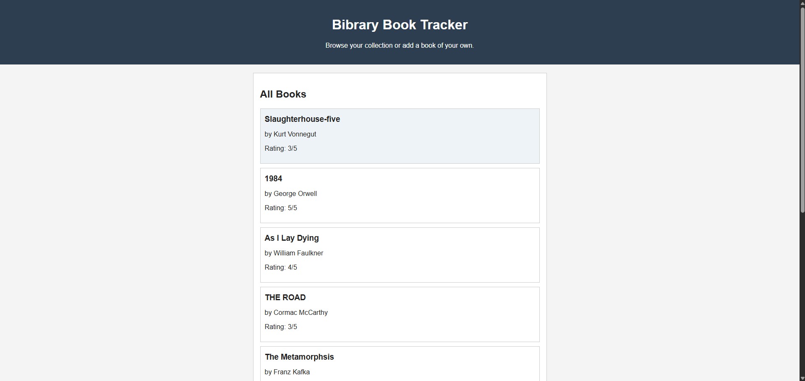
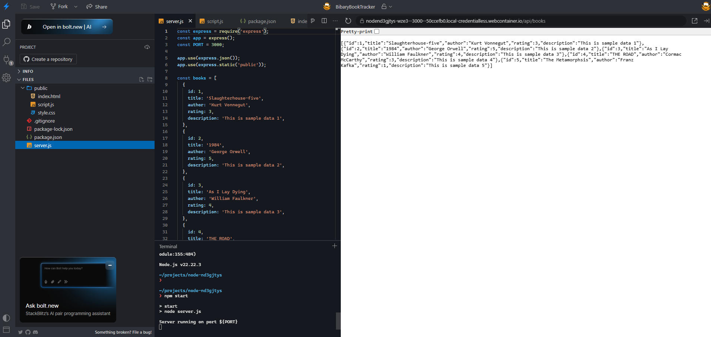
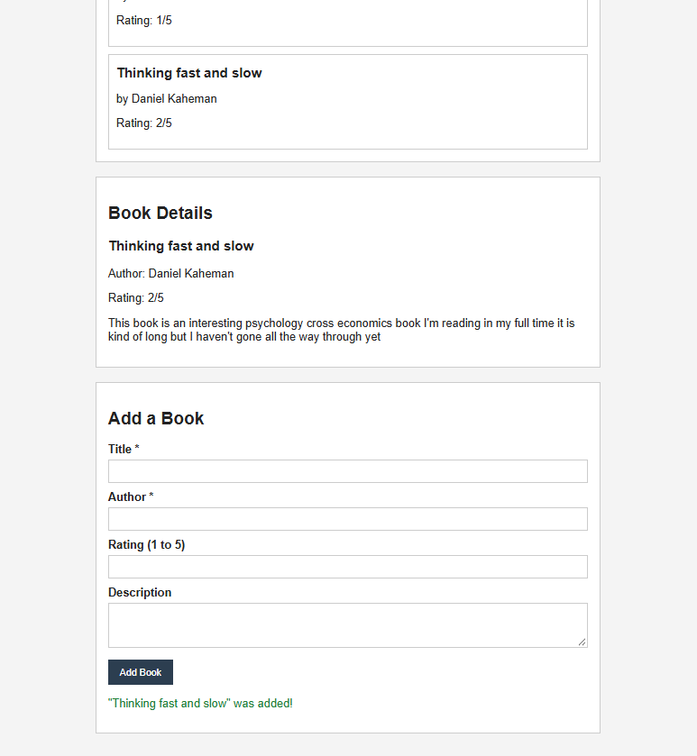
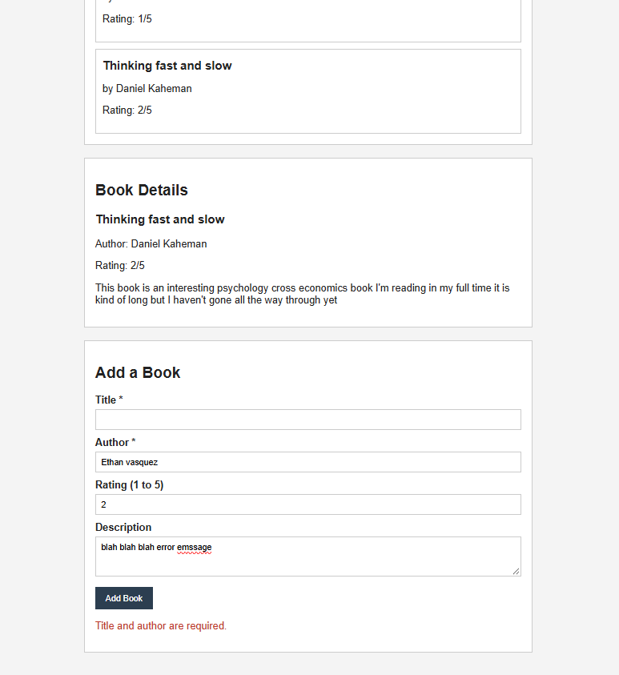

# BibraryBookTracker
CGS3853 Project #5: Building a Node.js API

## Application Purpose
BibraryBookTracker is a book tracker built with Node.js and Express. The Express server provides a REST API for a small book directory, and the frontend uses `fetch()` to communicate with it. You can view all books, click a book to see its details, and add new books through a form.

Books are stored in a JavaScript array, so any books you add will reset when the server restarts.

## File Structure
```
├── server.js          # Express server and API routes
├── package.json
├── package-lock.json
├── README.md
├── public/
│   ├── index.html     # Page layout and form
│   ├── style.css      # Styling
│   └── script.js      # fetch() calls to the API
└── screenshots/       # Screenshots shown below
```

## Installing Dependencies
The only dependency is Express, which is already listed in `package.json`. In the terminal, run:

```
npm install
```

## Starting the Server
```
npm start
```

This runs `node server.js`. The server starts on port 3000, and you should see `Server running on port 3000` in the terminal.

## API Endpoints
| Method | Endpoint | Description |
|---|---|---|
| GET | `/api/books` | Returns all books. |
| GET | `/api/books/:id` | Returns a single book by its ID (e.g. `/api/books/2`). An invalid ID returns a 404 with a JSON error. |
| POST | `/api/books` | Adds a new book. Title and author are required. Rating (1 to 5) and description (300 characters max) are optional. Missing or invalid fields return a 400 with a JSON error. |

## Testing the Application in StackBlitz
1. Open the project's StackBlitz link, then run `npm install` and `npm start` in the terminal.
2. The preview opens on the right side. Click **Show All Books** to load the books from the API.
3. Click any book to see its details, including the description.
4. To test the GET endpoints directly, add the route to the end of the **preview** URL (not the editor URL). For example, if the preview URL is `https://TEST.webcontainer.io`, go to `https://TEST.webcontainer.io/api/books` to see all books as JSON, or `https://TEST.webcontainer.io/api/books/2` for a single book.
5. To test the POST endpoint, fill out the **Add a Book** form with a title and author and submit it. A success message appears and the new book shows up in the list.
6. To test error handling, submit the form with the author left blank. The page shows "Title and author are required." from the server's 400 response.

## Screenshots

### Server running


### Frontend displaying books from the backend


### JSON response from `GET /api/books`


### A new book added through the form (POST)


### Error message when a required field is missing

